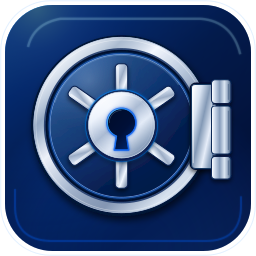

<p align="center"></p>

# The Vault

A native macOS password manager in Rust: no webview, local-first, and one encrypted file you can put anywhere.

## Status

Pre-release and not yet signed or notarized. It is built and reviewed by an agent pipeline and tested by the owner on macOS. Expect rough edges and do not rely on it as your only copy of important secrets.

## Features

- Three-column, keyboard-first UI in light and dark themes (gpui, no webview)
- Touch ID unlock through a Secure Enclave wrapped key
- TOTP codes with a countdown, including QR-code import from an image file
- Password and passphrase generator
- Tags, search, and weak or reused password warnings (local audit)
- File attachments, encrypted per file, up to 100 MB each
- Sync through any folder (iCloud Drive, Dropbox, NAS) with field-level merge and conflict-copy absorption
- Rotating encrypted backups
- Import from CSV, 1Password (1PUX), and KeePass (KDBX 3/4, with optional key file)
- Forward-compatible file format: unknown slot, item, and field kinds are preserved
- Command-line tool for scripting and debugging

## Security in brief

- Master password goes through Argon2id, calibrated to at least 500 ms on your machine
- Each item is encrypted with XChaCha20-Poly1305 and authenticated metadata, so swapped or rolled-back items are detected (replacing the whole file with an older complete copy is not; see the threat model)
- The manifest is encrypted, and subkeys are derived with HKDF
- Vault encryption uses RustCrypto crates, with no custom primitives; KeePass import uses the `keepass` parser
- The file leaks only the item count, item UUIDs, last-modified times, and creation time

Not protected: malware or physical access on an unlocked session, and a weak master password. Unlock factors protect the file at rest only.

See the threat model in [specs/00-overview.md](specs/00-overview.md) and the notes in [docs/research/](docs/research/).

## Requirements

- macOS 15 or later
- Rust, at the version pinned in `rust-toolchain.toml` (rustup picks it up automatically)
- Xcode command line tools

## Build and run

```sh
cargo build --workspace
cargo test --workspace
cargo clippy --workspace --all-targets -- -D warnings
cargo fmt --all -- --check
cargo run -p vault-app
cargo run -p vault-cli -- --help
```

The app excludes its windows from screen capture. For screenshots in debug builds only, set `VAULT_ALLOW_SCREEN_CAPTURE=1`. Release builds ignore it.

## CLI quick example

```sh
export VAULT_FILE=~/Documents/personal.vault
cargo run -p vault-cli -- init
cargo run -p vault-cli -- add --template login --title GitHub --username me --password-field --totp-field
cargo run -p vault-cli -- get GitHub --reveal
cargo run -p vault-cli -- totp GitHub
cargo run -p vault-cli -- attach add GitHub ./recovery-codes.txt
```

Other subcommands: `list`, `rm`, `gen`, `export`, `import`, and `attach list|get|rm`. Use `--password-env <VAR>` to read the master password from the environment in scripts. `init` refuses a master password under 50 bits unless `--allow-weak` is given.

## Packaging

```sh
scripts/package.sh --skip-sign --skip-notarize   # unsigned local bundle
scripts/package.sh --dry-run                     # print the signing commands only
```

Output goes to `target/package/` as `Vault.app` and a `.dmg`. A signed build needs a Developer ID identity in `VAULT_SIGN_IDENTITY` and a notarytool keychain profile in `VAULT_NOTARY_KEYCHAIN_PROFILE`. The entitlement checker (`scripts/check-entitlements.sh`) refuses builds with weakened hardened-runtime entitlements. Details are in [scripts/README.md](scripts/README.md).

## Vault file layout

- `<name>.vault/`: a macOS package (one Finder item) containing:
  - `vault.bin`: the encrypted vault file
  - `backups/`: rotating snapshots of `vault.bin` and absorbed conflict copies
  - `attachments/`: encrypted attachment blobs, one immutable file each

## Known limitations

- Attachments are not backed up. A restored backup may reference blobs that no longer exist, and the app shows them as missing.
- HEIC images have no in-app preview.
- No leaked-password checks, because the app never uses the network.
- No YubiKey, hardware key, or key file support for unlocking a Vault file.
- KeePass import transfers entries and password history, but not attachments, custom icons, or auto-type settings.
- Passkey unlock needs macOS 15 and is planned but not implemented yet.

## Project layout

```
Cargo.toml            workspace
crates/vault-core     format, crypto, items, merge, TOTP, generator, import/export
crates/vault-sync     file watching, atomic write, backup rotation, conflict handling
crates/vault-macos    Keychain, Touch ID, Secure Enclave, pasteboard, iCloud eviction
crates/vault-cli      thin CLI over core+sync (dev/debug tool, also phase-1 deliverable)
crates/vault-app      gpui app
specs/                the specs
```

## Specs and docs

- [specs/](specs/): start with `00-overview.md`, then the spec for the crate you touch (format, core API, sync, macOS, UI)
- [docs/research/](docs/research/): research notes behind scoping decisions
- [CLAUDE.md](CLAUDE.md): working rules for contributors and agents

## License

License: not yet chosen.
